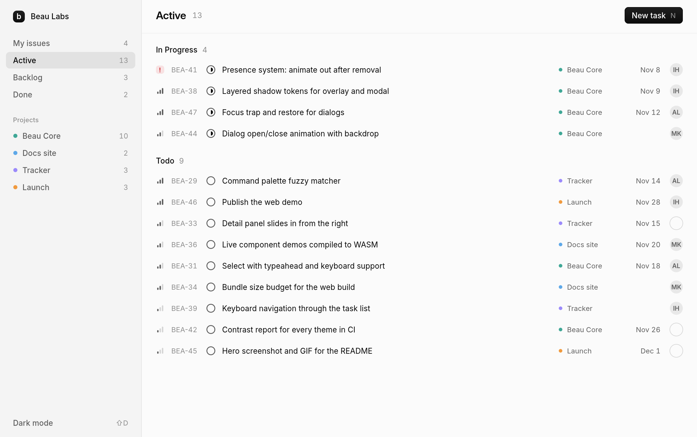
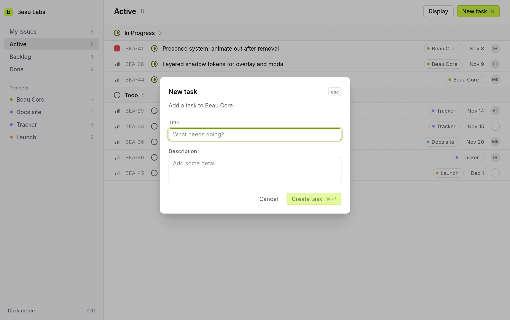

# beau

> [!NOTE]
> **AI-assisted development.** Some code in this repository is drafted with LLM
> tools. The architecture and design are set by the maintainer, and no change
> reaches `main` without being read, tested and approved by hand.

[](https://github.com/ibra/beau/actions/workflows/ci.yml)
[](#license)


A design system for [egui](https://github.com/emilk/egui). beau gives native
and web Rust apps a polished, consistent look with very little code: design
tokens, typography, drawing primitives, motion and components that are
designed together.



> [!NOTE]
> beau is pre-1.0 and not yet published to crates.io. APIs may change between
> minor versions; see the [changelog](crates/beau/CHANGELOG.md).

## Features

- **Design tokens.** A semantic palette, type scale, spacing, radii, elevation
  and motion timings for light and dark mode. Light and dark follow the OS.
- **Your colour, safely.** The default primary is ink. Set a brand accent and
  hover, focus, selection and on-accent colours are derived to meet WCAG
  contrast.
- **Typography.** Inter (variable, Latin subset) with real weights, a display
  optical size for headings and tabular figures so numbers align.
- **Drawing primitives.** Layered soft shadows, anti-aliased gradients,
  physical-pixel hairlines and focus rings.
- **Motion.** Frame-rate-independent springs and *presence*: elements and list
  rows animate out after you stop drawing them. Nothing repaints while idle.
- **Components.** `Button`, `TextInput`, `Card`, `Dialog` and `Kbd`, with more
  on the [roadmap](https://github.com/ibra/beau/milestones).
- **Native and web.** Everything builds for desktop and WebAssembly.

## Installation

Until the first crates.io release, depend on the repository:

```toml
[dependencies]
beau = { git = "https://github.com/ibra/beau" }
egui = "0.37"
```

## Usage

Install beau once, then use its components alongside regular egui code:

```rust
// In your eframe app's constructor:
beau::install(&cc.egui_ctx);

// In your UI:
if ui.add(beau::Button::new("Create").primary()).clicked() {
    // ...
}
```

Use your brand colour as the accent:

```rust
beau::install_with_accent(&cc.egui_ctx, egui::Color32::from_rgb(0x3B, 0x82, 0xF6));
```

Force light or dark instead of following the OS:

```rust
beau::set_preference(ctx, egui::ThemePreference::Dark);
```

## Example app

`examples/tracker` is a small task tracker used as the showcase and test bed.

```sh
cargo run -p tracker                      # native
cd examples/tracker && trunk serve        # web
```

| Light | Dark |
| --- | --- |
|  |  |

## Design

[`DESIGN.md`](DESIGN.md) describes the visual language: tokens, motion
principles and the rules every component follows.

## Contributing

Contributions are welcome. Please read [CONTRIBUTING.md](CONTRIBUTING.md) and
the [Code of Conduct](CODE_OF_CONDUCT.md). Report security issues privately as
described in [SECURITY.md](SECURITY.md).

## License

Licensed under either of

- Apache License, Version 2.0 ([LICENSE-APACHE](LICENSE-APACHE))
- MIT license ([LICENSE-MIT](LICENSE-MIT))

at your option. The bundled Inter font is licensed under the
[SIL Open Font License 1.1](crates/beau/assets/fonts/OFL.txt).
